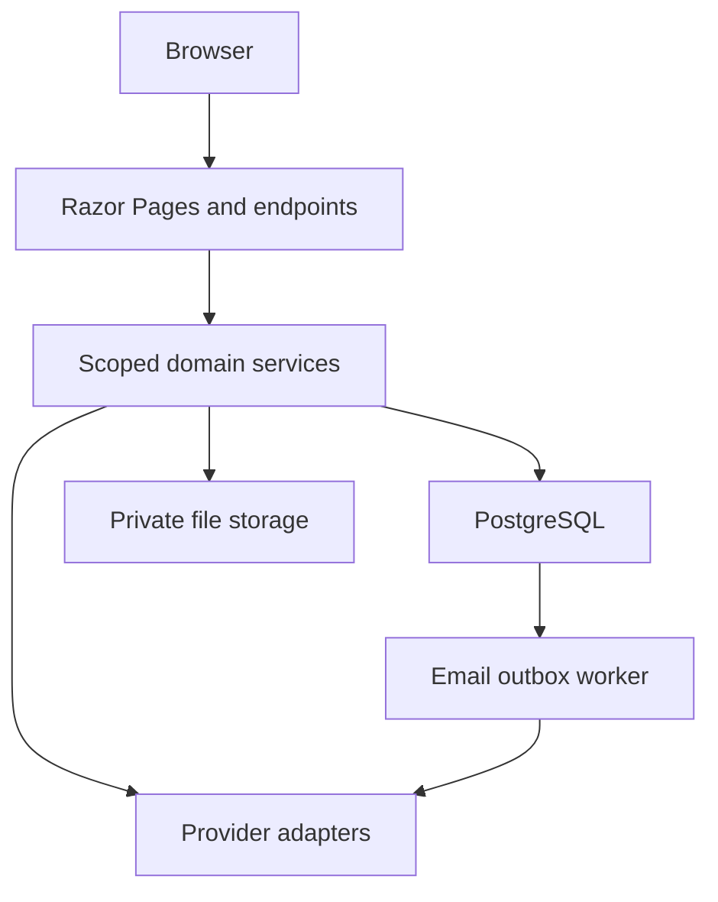

# Architecture

DualPath is a modular ASP.NET Core application. Razor Pages render the interface on the server. Domain services own state transitions and access checks; EF Core and PostgreSQL persist the records. JavaScript is limited to navigation and progressive enhancement. No Node service is required in production.

## Boundaries

| Boundary | Enforcement |
|---|---|
| Anonymous / authenticated | Identity cookies, confirmed email, POST antiforgery validation |
| Student / instructor | Assigned cohort instructor and active membership checked in services |
| Institution / institution | Organisation-scoped queries, invitation email binding, active memberships |
| Platform operations / private learning | Administration is explicit. Platform administrators do not automatically read or grade private student submissions |
| Public / draft lesson | Draft JSON is separate; publishing creates a versioned immutable snapshot |
| Draft / submitted assignment | Submission locks editing; each resubmission and review retains its revision |
| Free / paid content | Foundations are free. Other modules require a valid personal or institution subscription |
| Checkout return / entitlement | Return URLs never activate access; verified subscription webhooks do |
| AI / human assessment | AI is optional practice. Only instructors publish rubric decisions |

`Access` centralises record scopes. Never rely on a hidden button or a role label as authorisation. Every mutating service checks the actor, target and scope again. Mixed roles across institutions do not grant global instructor access.

## Consistency

Unique database indexes prevent duplicate membership, enrolment, lesson completion, published snapshots, reviews and provider event processing. Optimistic version checks reject stale edits. PostgreSQL transaction advisory locks serialize seat acceptance, learner state transitions, content publishing and billing reconciliation. Attachment upload shares the learner lock with submission, so submitted work cannot gain a later attachment.

Email is written to the same transactional database as the action it accompanies. A leased outbox worker sends messages with provider idempotency keys, bounded retry delays and a failed state visible to operations. Provider downtime leaves saved work intact.

## Content and evidence

The five core modules contain twenty original lessons and knowledge checks; these are real curriculum content, not fabricated learner activity. Demo users, an institution, enrolment and a development-only plan are opt-in and rejected in Production. Production never receives seeded fake reviews, testimonials, revenue or customer metrics.

## Scaling choices

Start with one web replica and a persistent `App_Data` volume. Multiple replicas require shared Data Protection keys and private file storage with the same authorisation semantics. The outbox leasing supports multiple workers. In-process request rate limits apply per replica; use a host-level shared limit when scaling out. Reporting is scoped and capped at 5,000 active enrolments per export. This is an intentional startup architecture, not a claim of unlimited capacity.
